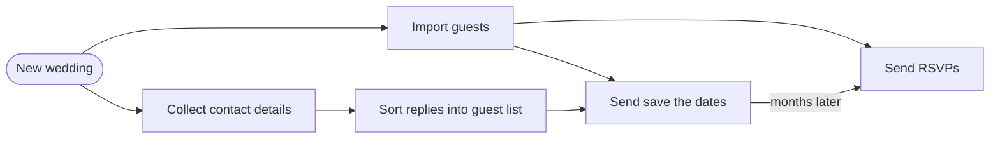
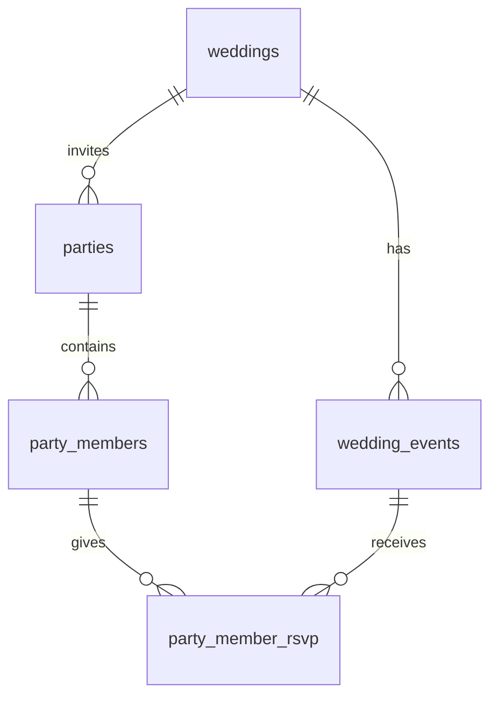
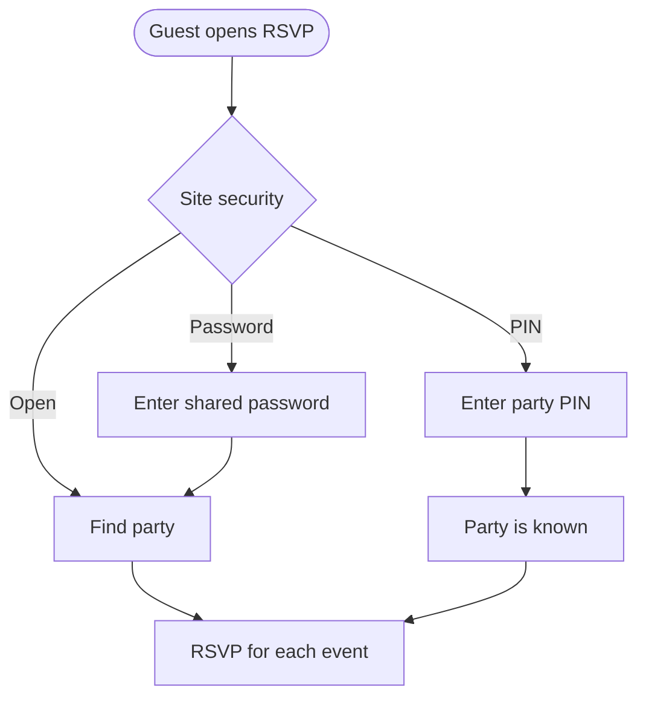

# Product vision

Date: 2026-11-25

This document records the target state of Dearest. It is not a build plan.
Each feature gets its own design in `docs/superpowers/specs/`.

## What the product does

Dearest helps a couple manage the outbound communication for their
wedding. There are three steps. Each step is optional. A couple does the
steps that fit them.

1. **Build the guest list.** Import guests, or collect contact details
   with a form.
2. **Send save the dates.** Tell guests the date early.
3. **Collect RSVPs.** Guests say which events they will go to.

## Example paths

- Import guests, then send RSVPs.
- Import guests, send save the dates, then send RSVPs months later.
- Collect contact details, send save the dates, then send RSVPs.

## Core concepts

| Concept | Example | Today |
| --- | --- | --- |
| `weddings` | Will & Julia | Exists as `tenants` |
| `wedding_events` | The ceremony, the reception, the dinner the evening before, the golf the day after | Not built |
| `parties` | The Smith family | Not built |
| `party_members` | John Smith, Amanda Smith | Not built |
| `party_member_rsvp` | Whether one party member goes to one wedding event | Not built |

## Outbound channels

The product contacts guests and parties by:

- email
- WhatsApp

## Site security

The couple picks one security level for the wedding website and RSVP.

| Level | How it works | What it proves |
| --- | --- | --- |
| Open | Anyone can find the site, find a party and RSVP. Not recommended. | Nothing |
| Password | One shared password opens the site. Anyone with the password can find a party and RSVP. | The person is invited |
| PIN | Each party gets its own PIN. The PIN identifies the party. | The person is invited, and the person is who they say they are |

## Auth for each step

| Step | Guest response | Auth |
| --- | --- | --- |
| Contact collection | Yes, a form | None. Anyone can submit. The couple sorts submissions into the guest list. |
| Save the dates | No | None |
| RSVP | Yes | The security level of the wedding. RSVP needs authentication and authorization. |

