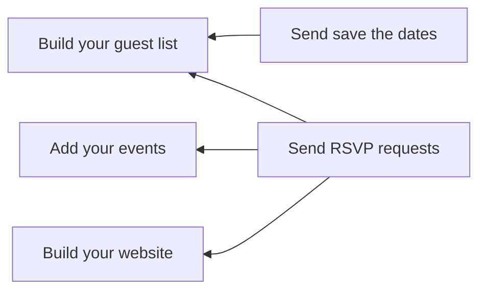
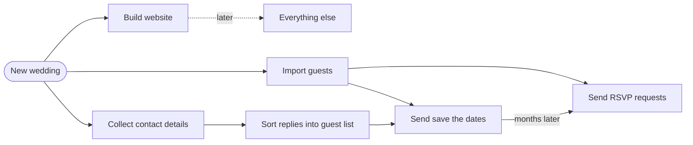
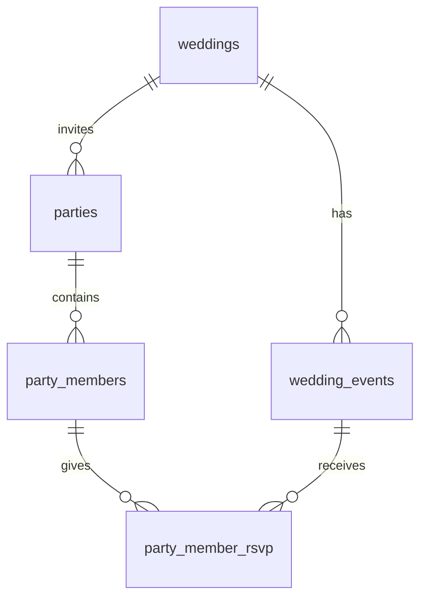

# Product vision

Date: 2026-11-25

This document records the target state of Dearest. It is not a build plan.
Each feature gets its own design in `docs/superpowers/specs/`.

## What the product does

Dearest helps a couple set up their wedding and manage the outbound
communication to their guests. There are five steps in three groups. Each
step is optional. A couple does the steps that fit them.

**Your wedding**

- **Add your events.** The ceremony, the reception, the golf the day after.
  Each event has its own RSVP questions, such as meal choice and dietary
  needs.
- **Build your website.** Put the wedding details online, with a security
  level (see [Site security](#site-security)) and an address (see
  [Website address](#website-address)).

**Your guests**

- **Build your guest list.** Import guests, or collect contact details
  with a form. Choose which people are invited to which event. The RSVP
  replies show here, next to each person.

**Messages to your guests**

- **Send save the dates.** Tell guests the date early. No reply needed.
- **Send RSVP requests.** Ask guests to reply on the website for each
  event, and remind the ones who have not replied.

## Step dependencies

The steps are a graph, not a sequence. A couple can start at any step. An
arrow means "needs".

`Add your events`, `Build your website` and `Build your guest list` need
nothing. A couple can send save the dates before they finalise the events.

## Example paths

- Put up a website first, then do the rest later.
- Import guests, then send RSVP requests.
- Import guests, send save the dates, then send RSVP requests months later.
- Collect contact details, send save the dates, then send RSVP requests.

## Core concepts

| Concept | Example | Today |
| --- | --- | --- |
| `weddings` | Will & Julia | Exists as `tenants` |
| `wedding_events` | The ceremony, the reception, the dinner the evening before, the golf the day after | Not built |
| `parties` | The Smith family | Not built |
| `party_members` | John Smith, Amanda Smith | Not built |
| `party_member_rsvp` | Whether one party member goes to one wedding event | Not built |

## Outbound channels

The product contacts guests and parties by:

- email
- WhatsApp

## Website address

Each wedding website has an address of the form `dearest.rsvp/to/<slug>`,
for example `dearest.rsvp/to/alex-and-sam`.

- The couple chooses the slug in the website setup.
- A slug is unique across all weddings.
- The app header shows the logo and `/to/<slug>` on every page, so a
  wedding planner with many weddings always sees which wedding is open.
- Until the couple chooses a slug, the app makes one from the wedding
  name: lower case, `&` becomes `and`, accents are removed and other
  characters become one `-`. The API does not store a slug yet.

## Site security

The couple picks one security level for the wedding website and RSVP.

| Level | How it works | What it proves |
| --- | --- | --- |
| Open | Anyone can find the site, find a party and RSVP. Not recommended. | Nothing |
| Password | One shared password opens the site. Anyone with the password can find a party and RSVP. | The person is invited |
| PIN | Each party gets its own PIN. The PIN identifies the party. | The person is invited, and the person is who they say they are |

## Auth for each step

| Step | Guest response | Auth |
| --- | --- | --- |
| Contact collection | Yes, a form | None. Anyone can submit. The couple sorts submissions into the guest list. |
| Save the dates | No | None |
| RSVP | Yes | The security level of the wedding. RSVP needs authentication and authorization. |

